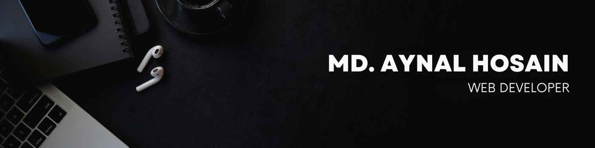

<!-- Banner Image -->

  

<!-- Social Icons -->

  
  
  
  
  
  
  

---

### ▶ About Me

Hi, I’m MD Aynal Hossain — a dedicated MERN Stack Web Developer who loves solving problems and building clean, scalable web applications.  
With experience in both front-end and back-end development, I work with technologies like React.js, Node.js, Express.js, and MongoDB to turn ideas into reality.  
Whether it’s a full-stack solution or API integration, I focus on writing clean code, optimizing performance, and delivering user-centric interfaces.

---

### ☑️ Skills & Technologies

- **Front-End** : HTML5, CSS3, Sass, Bootstrap, Tailwind, JavaScript, jQuery, React JS  
- **Back-End** : Node.js, Express.js, PHP, Laravel  
- **Database** : MongoDB, MySQL  
- **Version Control** : Git, GitHub  
- Responsive Web Design  
- UI/UX Design Principles  
- Cross-Browser Compatibility  
- Web Performance Optimization  
- Problem Solving  

---

### 🎓 Education

- Diploma in Computer Science  
- Web Application Development Training  

---

### 📞 Contact Information

- 📧 Email: hossainaynal16@gmail.com  
- 📱 Phone: +8801727147610
- 🔗 GitHub: [github.com/aynal-hub](https://github.com/aynal-hub)  
- 🔗 LinkedIn: [linkedin.com/in/hossainaynal16](https://linkedin.com/in/hossainaynal16)  
- 🔗 Facebook: [facebook.com/hossainaynal16](https://www.facebook.com/hossainaynal16)  
- 🔗 Fiverr: [fiverr.com/leadexpert_4](https://www.fiverr.com/leadexpert_4)

---

### 🌍 Languages

- Fluent in English  
- Conversational in Hindi  
- Basic in Bangla  
